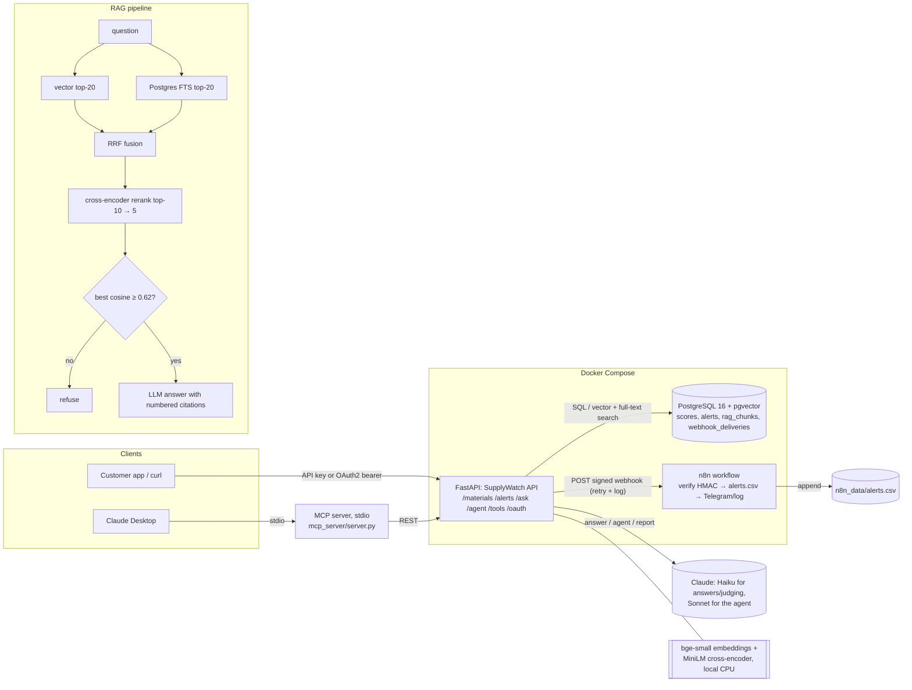

# SupplyWatch Copilot

[](https://github.com/malhar-sk/supplywatch-copilot/actions/workflows/ci.yml)
[](https://github.com/malhar-sk/supplywatch-copilot/actions/workflows/podman.yml)
[](LICENSE)

**Ask-anything copilot for critical-mineral supply risk: RAG with evals, a LangGraph agent, an MCP
server, and webhook-driven n8n alerting.**

SupplyWatch is a B2B API that scores disruption risk (0–100) for critical minerals. This project
turns it into something a customer can *talk to* and *wire into their tools*:

- **`POST /ask`**: answers questions from a 203-document corpus (154 real USGS *Mineral Commodity
  Summaries* 2024/2025 sections plus 49 **synthetic** supplier and news docs), with citations. It
  says so when it doesn't know.
- **`POST /agent`**: a LangGraph analyst agent that calls tools (live risk signal, score history,
  supplier exposure, document search, structured risk report) and returns its tool-call trace.
- **MCP server**: the same tools, available to Claude Desktop or any MCP client.
- **Signed webhooks → n8n**: when a material's score crosses a subscriber's threshold, an
  HMAC-SHA256-signed event (with retries and a delivery log) goes to an n8n workflow. The workflow
  verifies the signature, appends to a CSV, and sends a Telegram message (or logs it).
- **OAuth2 client credentials**: short-lived scoped JWTs alongside the original API keys.
- **Measured evaluation**: RAGAS plus retrieval and refusal metrics on a 50-question golden set,
  baseline vs improved retrieval. See [Results](#results).

> **Data honesty.** Score history is **synthetic** (seeded random walk, tagged `synthetic_seed`).
> Supplier companies and the "Acme Drives" customer are **fictional** (`data/suppliers.json`,
> docs tagged `synthetic: true`). The USGS text is real, public-domain, and every document stores
> its source URL and fetch date.

## Architecture



**Agent graph (LangGraph):** `START → agent ⇄ tools (ToolNode) → END`, with
`tools_condition` routing. Tools: `get_material_signal`, `get_material_history`,
`supplier_exposure`, `search_documents`, `write_risk_report` (JSON schema adapted from
PharmaWatch's supply-chain report).

## Stack

Python 3.11 · FastAPI · SQLAlchemy 2 (async) + asyncpg · PostgreSQL 16 + **pgvector** (HNSW) ·
Postgres full-text search · **sentence-transformers** (`BAAI/bge-small-en-v1.5`,
`cross-encoder/ms-marco-MiniLM-L-6-v2`) on CPU · **LangGraph** · **MCP Python SDK** (FastMCP) ·
**RAGAS** · Claude (Haiku / Sonnet) · **n8n** · PyJWT · pytest · Docker Compose · GitHub Actions.

## Quick start

```bash
cp .env.example .env            # optionally add ANTHROPIC_API_KEY
docker compose up -d --build    # db + api + n8n
docker compose exec api python scripts/seed.py
curl localhost:18000/health
```
Then follow **[TESTING.md](TESTING.md)**: ask questions, run the evals, connect Claude Desktop,
simulate a spike, use OAuth. For a customer-facing integration guide, see
**[docs/ONBOARDING.md](docs/ONBOARDING.md)**.

| Command | What |
|---|---|
| `make up` / `make down` | start / stop everything |
| `make seed` | materials + synthetic history + corpus ingest |
| `make test` | full test suite (LLM mocked; needs the compose db) |
| `make eval` | baseline + improved eval with RAGAS → `evals/results/REPORT.md` |
| `make simulate` | force a threshold crossing → n8n → `n8n_data/alerts.csv` |
| `make corpus` | rebuild `data/corpus` (fetch USGS PDFs, generate synthetic news) |

## Container runtime

Runs with **Docker** (Docker Desktop on Windows/macOS, Docker Engine on Linux) using `docker compose up -d`.
The Compose file sticks to the standard Compose spec, so other Compose-compatible tools (Podman, OrbStack,
Rancher Desktop, Colima) can run it too. Tested with rootless Podman 4.9.3 + podman-compose 1.3.0 (see `.github/workflows/podman.yml`).
Why Docker and not the others: [docs/adr/0001-container-runtime.md](docs/adr/0001-container-runtime.md).

## Results

Full tables, commands, dates and dataset sizes: **[RESULTS.md](RESULTS.md)**.

| Metric (50-question golden set, 2026-11-22) | Baseline: vector | Improved: hybrid + rerank |
|---|---|---|
| RAGAS faithfulness | 0.883 | 0.892 |
| RAGAS context recall | 0.921 | 0.954 |
| Retrieval hit@5 | 0.950 | 1.000 |
| Refusal accuracy (not-in-corpus) | 1.000 | 1.000 |
| `/ask` p95 latency | 5.7 s | 6.5 s |

The reranker buys recall at about 1.1 s of CPU per query. The improvement was picked on the same
set it is measured on (three configs tried), so treat the gain as optimistic.

**Eval round 2 (2026-11-23):**
- **The faithfulness gap is noise.** Three runs of the improved config span 0.892–0.938 (mean 0.922),
  about 5× the 0.009 gap.
- **The retrieval gain is stable.** hit@5 was 1.00 in all three runs.
- **The reranker earns its 1.1 s on only 2 of 40 questions.** It lifts them from rank 7 into the top 5, and
  every config has hit@10 = 1.0.
- **Agent eval** (`/agent`, Haiku, 20 synthetic questions): answer correctness **0.70**, tool-selection
  precision 1.00 and recall 0.85, p95 latency 13.6 s.

## Repository map

```
app/                 FastAPI service (the SupplyWatch source + copilot packages)
  rag/               chunking, embeddings, vector/hybrid/rerank retrieval, grounded answering
  agent/             LangGraph graph, tools, chat-model adapters
  webhooks/          HMAC signing, delivery with retry/backoff, edge-triggered alerts
  oauth/             client-credentials grant, JWTs, scopes
  tests/             source tests + copilot tests
mcp_server/          stdio MCP server (FastMCP) over the REST API
evals/               golden.jsonl (50), run_eval.py (RAGAS + own metrics), results/
n8n/workflows/       importable risk_alert.json (generated by n8n/build_workflow.py)
data/corpus/         usgs/ (real) and synthetic/ documents; data/suppliers.json (fictional)
scripts/             build_corpus.py, simulate_spike.py, record_agent_run.py
docs/ONBOARDING.md   customer engineer guide
.github/workflows/   GitHub Actions: ci.yml (pytest + pgvector service, mocked LLM), podman.yml (rootless Podman run)
```

## Related projects

- [fleet-voice-agent](https://github.com/malhar-sk/fleet-voice-agent): multilingual voice agent over a VictoriaMetrics/Grafana device fleet
- [mt103-extractor-lora](https://github.com/malhar-sk/mt103-extractor-lora): LoRA fine-tuned 0.5B model that turns messy payment text into MT103 JSON

## Credits

Built on two of my earlier projects: **SupplyWatch** (FastAPI B2B risk API; copied into `app/`,
with its tests kept passing) and **PharmaWatch** (Claude supply-chain risk reports; its JSON report
schema was adapted for `write_risk_report`). USGS Mineral Commodity Summaries are U.S. Government
works in the public domain. Unattended build decisions are logged in [DECISIONS.md](DECISIONS.md).

## What I'd do next

- **A dev/test split for the golden set.** The retrieval improvement was chosen by looking at this
  same 50-question set (3 configs tried). Grow it to about 200 questions, tune on one half, and
  report on the other.
- **Better table handling.** The USGS world-production tables come out of PDF extraction as flat
  text. Parsing them into rows (country, production, reserves) would make numeric and comparison
  questions much more reliable.
- **Per-subscription webhook secrets with rotation** (today one shared secret), and a dead-letter
  queue with replay from `webhook_deliveries`.
- **Streaming `/ask`** and caching retrieval for repeated questions. Most `/ask` latency is the LLM call.
- **A human-labelled answer set** alongside RAGAS, to check how well the LLM judge agrees with people.

